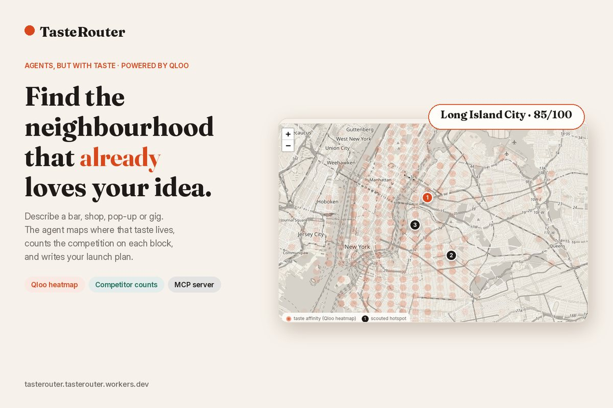
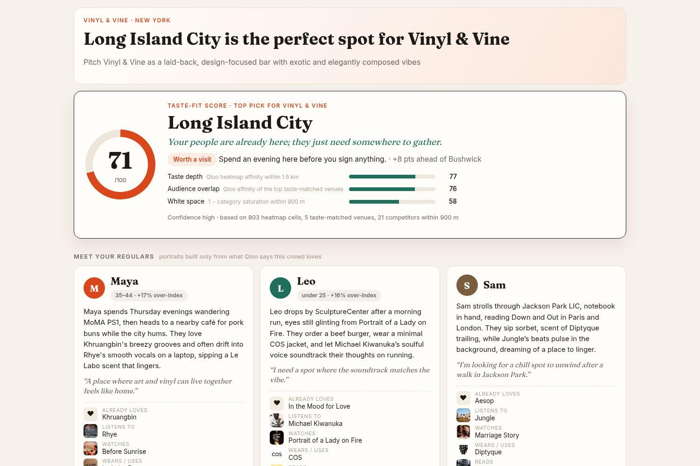
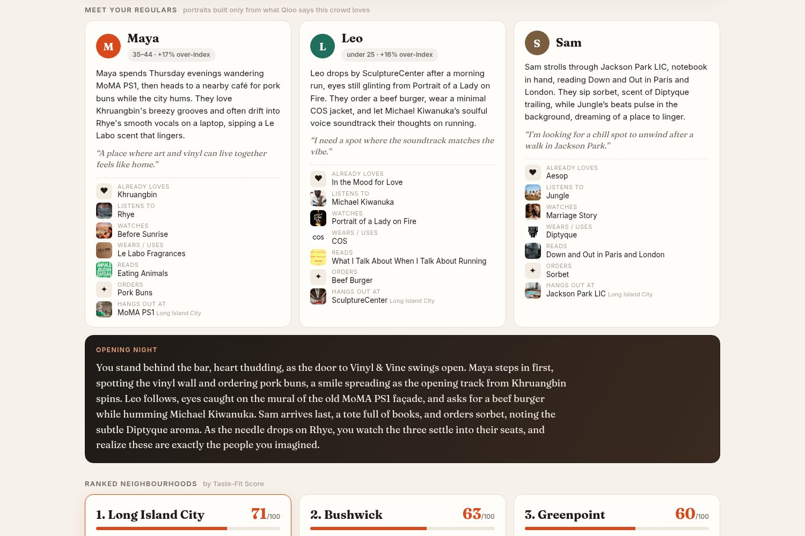
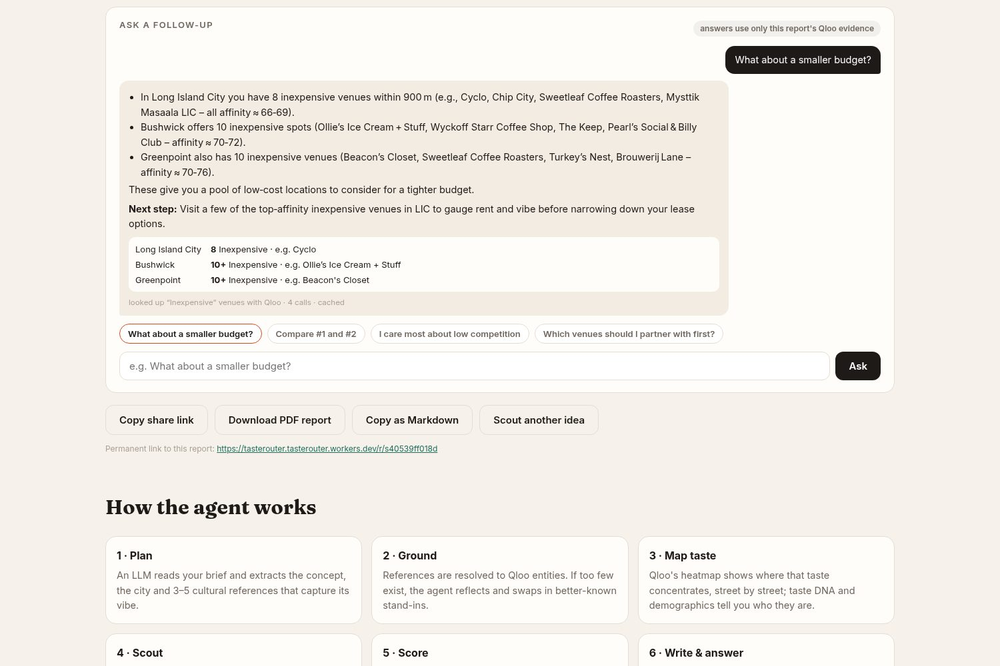
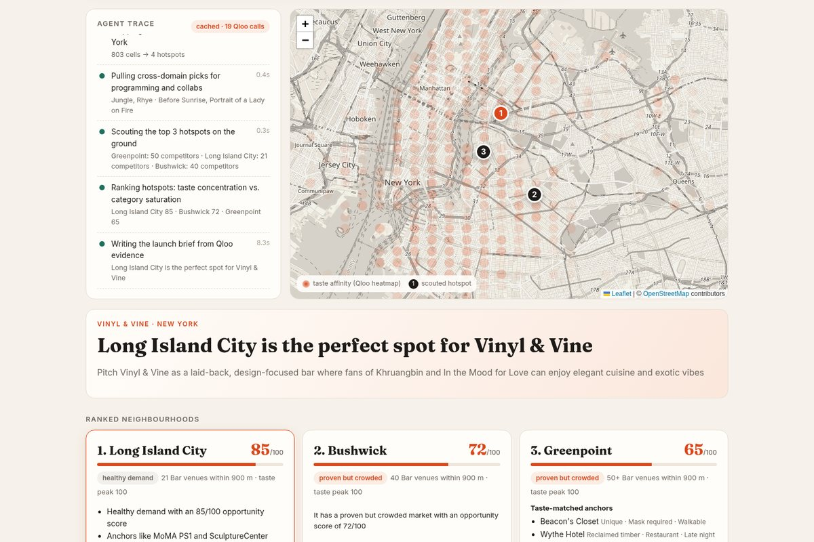
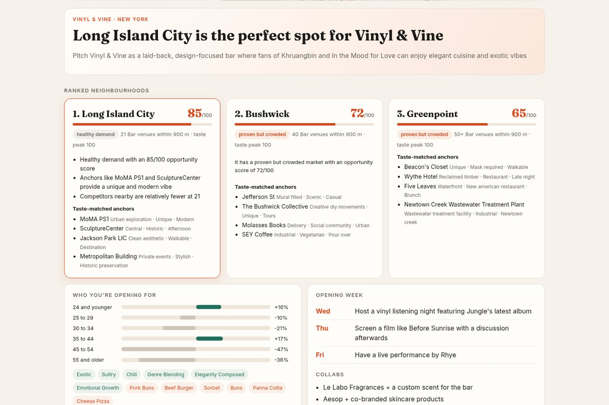
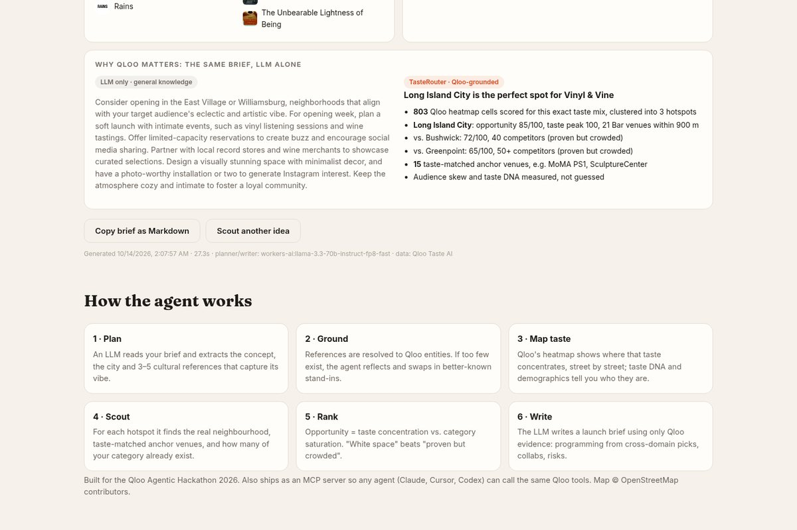
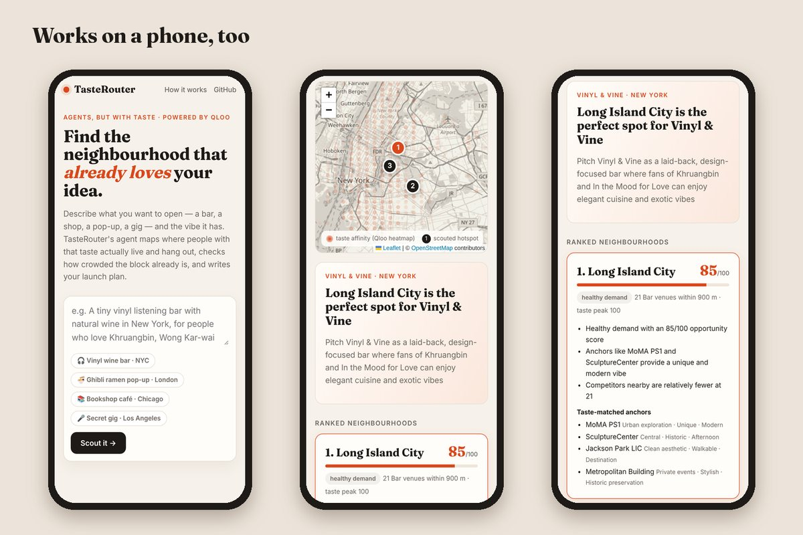
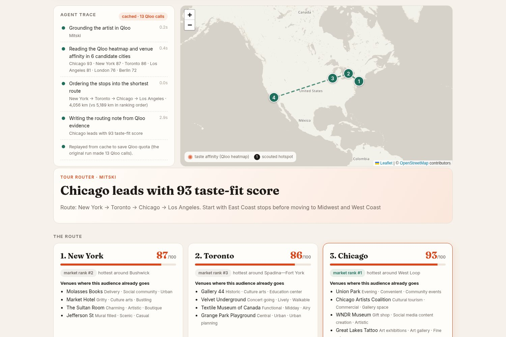

# TasteRouter — find the neighbourhood that already loves your idea

**Live demo: https://tasterouter.tasterouter.workers.dev** · Built for the [Qloo Agentic Hackathon 2026](https://qloo.devpost.com/)



Opening a small place means betting your savings on a feeling: that *your people* are out there. TasteRouter is an AI agent for that moment. Describe the place you dream of — *"a tiny vinyl listening bar with natural wine in New York, for people who love Khruangbin, Wong Kar-wai films and Aesop-style design"* — and it finds **the neighbourhood whose residents already share that taste**, introduces you to **your future regulars**, tells the story of your **opening night**, and gives you one number to trust before you sign a lease: the **Taste-Fit Score**.

> Site selection today means foot-traffic counts and rent maps. They tell you how many people walk past — not whether any of them will love what you're making. Qloo knows where taste lives. TasteRouter turns that into a decision you can feel good about.

### TasteRouter vs. the alternatives

| | Gut feel / asking friends | Foot-traffic & site-selection tools | ChatGPT alone | **TasteRouter** |
|---|---|---|---|---|
| Answers "will people *like this* come?" | hopefully | no (counts bodies, not taste) | guesses | **yes: Qloo taste graph, street-level heatmap** |
| Data source | anecdotes | phone pings, census | training data | **Qloo heatmap, place index, demographics, cross-domain recs** |
| Who your customers are | imagined | demographics only | stereotypes | **Qloo-grounded "regulars": what they listen to, watch, wear, eat, where they go** |
| Competition check | walking around | yes | no | **yes: same-category venues within 900 m from Qloo** |
| Time / cost | weeks, free | days, typically paid subscriptions or consultants | seconds, free | **~20 s, free** |
| Auditable | no | partly | no | **every step and Qloo call is shown; shareable report** |

## Why this only works with Qloo

Ask an LLM alone and you get the same three famous neighbourhoods for every "cool" concept (the demo shows this side by side). TasteRouter's answer comes from Qloo's taste graph:

| Question | Qloo capability used |
|---|---|
| What do these references have in common? | `GET /search` → entity resolution, `/v2/insights` `filter.type=urn:tag` (taste DNA) |
| Who is the audience? | `/v2/insights` `filter.type=urn:demographics` (age/gender lift) |
| **Where in the city does that taste concentrate?** | `/v2/insights` `filter.type=urn:heatmap` with a point + radius window → street-level geohash affinity |
| What's actually there, and does it fit? | `/v2/insights` `filter.type=urn:entity:place`, `filter.location=POINT(..)` + `signal.interests.entities` → neighbourhood name + taste-matched anchor venues |
| How crowded is my category there? | `/v2/insights` places with `filter.tags=<category tag from /v2/tags>` around each hotspot → competitor count |
| What should I play / screen / stock / collab with? | `/v2/insights` cross-domain: artists, movies, brands, books; plus `signal.location.query` for local-leaning artists |

Remove Qloo and nothing is left: there is no heatmap, no anchors, no competitor count — the brief would be guesswork.

## How the agent works

```
brief ─▶ PLAN (LLM: concept, city, 3–5 cultural refs)
      ─▶ GROUND (Qloo /search, name-checked)  ──▶ REFLECT if < 2 refs resolve (LLM proposes stand-ins)
      ─▶ FAN OUT in parallel: concept tags · taste DNA · audience · heatmap · cross-domain programming
      ─▶ ADAPT (sparse heatmap → widen window and retry)
      ─▶ SCOUT top hotspots (neighbourhood, anchors, competitors)
      ─▶ SCORE Taste-Fit = 40·taste depth + 30·audience overlap + 30·(1 − category saturation)
               saturation = ½·relative to the other hotspots + ½·absolute (50 venues = saturated)
               ties → fewer competitors → stronger taste peak → more anchors; duplicate names get a compass suffix
      ─▶ WRITE (LLM writes the launch brief from Qloo evidence only; deterministic fallback)
      ─▶ STORY in parallel: 3 "regulars" from deterministic Qloo kits + opening night (retries if thin or gendered)
      ─▶ SAVE  report permalink /r/<id>; ASK follow-ups grounded on the stored evidence
```

Every step streams to the UI as an auditable trace (with a live Qloo-call counter), and the final brief is grounded only in the evidence object the agent assembled.

## Screenshots

| Taste-Fit verdict | Meet your regulars + opening night |
|---|---|
|  |  |
| **Follow-up chat** | |
|  | |

| Agent trace + Qloo heatmap | Ranked neighbourhoods |
|---|---|
|  |  |
| **LLM alone vs. Qloo-grounded** | **Mobile** |
|  |  |
| **Tour router** | |
|  | |

## Features

- **Taste-Fit Score (0–100) and a verdict card** ("Your people are here" / "Worth a visit" / "A harder road"): 40% *taste depth* (mean Qloo heatmap affinity within 1.5 km of the hotspot), 30% *audience overlap* (mean Qloo affinity of the top-3 taste-matched venues within 900 m), 30% *white space* (1 − category saturation). The card shows the three parts, the lead over #2 and the evidence behind it.
- **Meet your regulars**: three portraits of the people who will walk in. Their ingredients are chosen deterministically from Qloo (an over-indexed age band from `urn:demographics`, an artist, film, brand, book from cross-domain insights, a dish from the taste DNA, a real venue near the #1 hotspot); the LLM only writes prose around them, without assuming gender. Plus an **Opening night** story and a **"why you'll belong here"** line per neighbourhood.
- **Ranked neighbourhoods** with "white space / healthy demand / proven but crowded" labels, competitor counts within 900 m and taste-matched anchor venues.
- **Follow-up chat** on any finished report ("What about a smaller budget?", "Compare #1 and #2", "I care most about low competition"). The answer uses only the stored evidence plus at most one tool: a deterministic Taste-Fit re-score with new weights (0 Qloo calls) or a Qloo lookup of taste-matched venues with a given tag, e.g. *inexpensive*, around each hotspot (≤ 4 cached calls).
- **Shareable permalink** (`/r/<id>`, kept 120 days) and a print-ready **PDF report**.
- **Map** of the Qloo heatmap with the scouted hotspots.
- **Audience lift** by age and the **taste DNA** (vibe + menu cues) of the crowd.
- **Opening-week programming** and **collab partners** drawn from Qloo cross-domain recommendations.
- **"LLM alone vs. TasteRouter"** panel: the same brief answered without Qloo, for contrast.
- **Tour router / fan mode** (`POST /api/tour {artist, cities?, stops?}`, MCP tool `plan_tour`): shows where a touring artist's fans actually are, plans an **intimate fan night** in the strongest market (a taste-matched room near the fans + local openers from Qloo `signal.location`), ranks candidate cities by how strongly an artist's audience concentrates there, then orders the best stops into the shortest route. City score = mean Qloo affinity of the five most taste-matched venues around the city's hottest heatmap cluster (heatmap affinity is rank-normalised inside each city, so it finds *where* in a city but cannot compare cities; venue affinity can).
- **MCP server** (`src/mcp.js`) exposing `scout_location`, `plan_tour` plus each Qloo tool, so Claude / Cursor / Codex agents get the same grounding.
- Zero-competition hotspots are flagged as first-mover *white space* with a "validate demand on the ground" note, instead of silently scoring 100.
- Repeat briefs replay from Workers KV (the badge shows *cached*), so judges' clicks don't burn the Qloo quota.
- Copy the brief as Markdown.

## Architecture

- `src/agent.js` — the agent loop (plan, ground, reflect, fan-out, adapt, scout, rank, write) emitting step events.
- `src/tools.js` — Qloo-backed tools with tool specs.
- `src/qloo.js` — dependency-free Qloo client with a 4 req/s queue, retries and a pluggable persistent cache (the hackathon key allows 5 req/s and 10k/month).
- `src/ask.js` — grounded follow-up chat (tool router → re-score or Qloo venue lookup → answer).
- `src/llm.js` — Cloudflare Workers AI (Llama 3.3 70B for planning/briefs, gpt-oss-120b for the regulars, opening night and chat; free tier) or any OpenAI-compatible endpoint.
- `src/geo.js` — heatmap clustering; `src/geocode.js` — city window via OpenStreetMap Nominatim.
- `src/worker.js` — Cloudflare Worker: streaming NDJSON API + UI, Workers KV cache for Qloo responses and finished runs.
- `src/server.js` — the same app on plain Node 20 (zero dependencies).
- `public/` — the UI (vanilla JS + Leaflet).

## Run it yourself

```bash
git clone https://github.com/happy520ai/unified-ai-system && cd unified-ai-system/taste-router
export QLOO_API_KEY=your-hackathon-key            # https://docs.qloo.com/reference/qloo-llm-hackathon-developer-guide
export LLM_BASE_URL=https://openrouter.ai/api/v1 LLM_API_KEY=... LLM_MODEL=meta-llama/llama-3.3-70b-instruct   # any OpenAI-compatible LLM
npm start                 # http://localhost:8787
npm test                  # unit + agent tests, no network
```

Structured requests work without any LLM:

```bash
curl -N localhost:8787/api/scout -H 'content-type: application/json' \
  -d '{"city":"Chicago","concept":"bookshop cafe","seeds":["Phoebe Bridgers","Normal People","Patagonia"]}'
```

Deploy your own on Cloudflare's free plan: `npx wrangler kv namespace create CACHE` (put the id in `wrangler.toml`), `npx wrangler secret put QLOO_API_KEY`, `npx wrangler deploy`.

### MCP

```json
{ "mcpServers": { "taste-router": { "command": "node", "args": ["taste-router/src/mcp.js"], "env": { "QLOO_API_KEY": "your-key" } } } }
```

Tools: `scout_location`, `resolve_seeds`, `concept_tags`, `taste_dna`, `audience`, `hotspots`, `scout_hotspot`, `programming`.

## Limitations (honest ones)

- Qloo affinity measures taste concentration, not rent, zoning or foot traffic — TasteRouter is the first filter, not the lease decision.
- Competitor counts come from Qloo's place index around each hotspot (900 m) and cap at 50.
- Free-tier LLMs occasionally pick odd references; the agent name-checks every entity and reflects when too few resolve, and the trace shows exactly what was used.

## Built during the hackathon

TasteRouter was written from scratch between Sep 30 and Oct 30, 2026 as a new package inside `unified-ai-system` (an existing personal AI-gateway repo); none of this code existed before the submission period.

## License

Apache-2.0 — see [LICENSE](LICENSE) (same as the repository).
